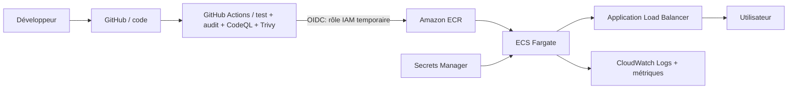

# TP3 — Rends ce repo prêt pour la prod (DevSecOps)

[](https://github.com/firestrom512/devsecops-tp/actions/workflows/ci.yml)

> Projet corrigé et publié sur GitHub. Vérifié le **21 novembre 2026** : 16 tests Jest réussis, **100 % de couverture des lignes**, audit des dépendances sans alerte HIGH/CRITICAL, CodeQL et scanner Trivy de l’image de production réussis. [Voir la CI verte](https://github.com/firestrom512/devsecops-tp/actions/runs/44923348699).

## Exécution

Pré-requis : Node.js 22, npm, Git. Docker facultatif pour le développement et nécessaire pour la partie image.

```bash
npm ci                       # Utilise le package-lock.json déjà commité
npm run lint
npm test                     # Jest + Supertest et couverture >= 80 %
npm audit --audit-level=high
npm start
```

Puis tester `http://localhost:3000/health`, `/hello?name=Lina`, `/prefs?theme=dark&lang=en`.

**Important :** `package-lock.json` a été généré sur GitHub Actions et commité dans `main`. Le pipeline et le Dockerfile utilisent `npm ci`. Le script Windows `scripts/publier.ps1` est conservé comme aide pédagogique ; il n'est plus nécessaire pour publier ce dépôt.

### Routes

| Route | Comportement sécurisé |
|---|---|
| `GET /health` | `200`, `{ "status": "ok" }` |
| `GET /hello?name=...` | Bonjour en HTML avec **échappement** des données utilisateur |
| `GET /ping?host=google.com` | `ping` sans shell, hôte validé et placé dans une allowlist, timeout |
| `GET /prefs?theme=dark&lang=en` | Seules `theme` et `lang` sont lues ; valeurs autorisées contrôlées |

Les 2 tests de départ sont conservés, avec des tests supplémentaires dont 3 régressions de sécurité dans `tests/security.test.js`.

## Sécurité & coûts

### 1. Secrets

- `.gitignore` exclut `.env`, les logs, `node_modules` et `coverage` ; `.env.example` contient uniquement `PORT=3000`.
- Configurer dans GitHub **Secret scanning**, **Push protection**, Dependabot et protection de branche. Leur activation par interface n'est **pas vérifiée** dans cette archive.

**Question — un collègue a supprimé une clé AWS fuitée du code : est-ce suffisant ?** Non. Une clé divulguée subsiste dans l'historique Git, des clones, des caches ou des journaux. Dans l'ordre : (1) **désactiver/révoquer immédiatement** la clé dans IAM, (2) analyser les événements CloudTrail et détecter les usages non autorisés, (3) générer un remplacement avec permissions minimales si nécessaire, distribuer via un gestionnaire de secrets, (4) nettoyer soigneusement l'historique et les traces accessibles, avec coordination des collaborateurs, (5) activer les protections et documenter l'incident. Un simple `git rm` n'annule pas la fuite.

### 2. Dépendances et audit

Le starter du professeur utilise **Express 4.17.1** et **Lodash 4.17.15**. Cette correction utilise **Express 5.3.0**. **Lodash est supprimé** car une sélection explicite de clés remplace `_.merge()` sans nécessiter cette dépendance. Jest et Supertest sont installés pour les tests. Dependabot inspecte `npm`, `github-actions` et `docker` chaque semaine (`.github/dependabot.yml`).

Le workflow `deps-audit` exécute `npm audit --audit-level=high` et bloque sur les vulnérabilités de gravité HIGH ou CRITICAL.

| Audit npm | Critical | High | Moderate | Low |
|---|---:|---:|---:|---:|
| Avant — dépendances du starter | **0** | **5** | **0** | **3** |
| Après — dépendances corrigées | **0** | **0** | **18** | **0** |

Les chiffres **avant** proviennent du job `baseline-audit` : il résout les dépendances du starter et exécute `npm audit` **sans installer ni lancer l'application vulnérable**. Les chiffres **après** viennent du job `deps-audit`. Les **18 vulnérabilités modérées restent présentes** dans les dépendances de développement et ne sont pas bloquantes au seuil exigé (`--audit-level=high`). [Preuves dans GitHub Actions](https://github.com/firestrom512/devsecops-tp/actions/runs/44923348699).

### 3. Correction des trois failles et tests de régression

| Route | Faille | URL de démonstration (sur serveur local uniquement) | Correction |
|---|---|---|---|
| `/hello` | XSS réfléchie | `/hello?name=%3Cscript%3Ealert(1)%3C%2Fscript%3E` | `escapeHtml()` encode les caractères spéciaux avant de construire la réponse HTML. |
| `/ping` | Injection de commande | `/ping?host=google.com%3Bwhoami` | `execFile` reçoit un tableau d'arguments ; pas de shell ; regex stricte + allowlist. |
| `/prefs` | Prototype pollution | `/prefs?__proto__%5Badmin%5D=true` | Jamais de `_.merge()` avec l'entrée utilisateur ; sélection de `theme`/`lang` uniquement. |

`tests/security.test.js` vérifie chacune de ces corrections et des cas limites (hôtes privés interdits, réponses propres, en-têtes d'identification). Le code final ne reproduit aucune de ces failles.

CodeQL est exécuté dans le job `CodeQL` du pipeline, **réussi sur la dernière exécution vérifiée**. Pour identifier des alertes éventuelles (règle, fichier, ligne, gravité), consulter **Security → Code scanning** dans GitHub. Un job vert n'est pas une preuve absolue qu'aucune alerte n'est ouverte.

### 4. Pipeline durci

- `push` et `pull_request` **vers `main` uniquement**.
- `permissions: contents: read` par défaut, exceptions spécifiques pour CodeQL.
- `timeout-minutes` sur tous les jobs.
- `npm ci`, cache npm, `concurrency` et `cancel-in-progress: true`.
- `test` (Jest + couverture), `deps-audit` (audit npm), `CodeQL` et `image` (Buildx + Trivy).
- Le job `image` attend `test` et `deps-audit` avant de construire l'image.
- Trivy est épinglé au commit **`ed142fd0673e97e23eac54620cfb913e5ce36c25`**, correspondant au tag v0.36.0, plutôt qu'à un tag mutable.

La protection de branche **nécessite un réglage manuel GitHub** : PR obligatoire, checks `test`, `deps-audit` et `CodeQL` obligatoires ; `image` recommandé aussi. Sur GitHub, configurer dans Settings → Rules.

**Question — incident Trivy de mars 2026 :** les tags des versions 0.0.1 à 0.34.2 (notamment `v0.34.0`) ont été compromis pendant l'incident du 19 mars 2026. Un workflow qui chargeait alors un tag détourné était exposé. Un workflow épinglé **avant l'incident sur le SHA d'un commit sain** résistait au détournement du tag ; épingler un SHA de code malveillant n'aurait pas protégé. Source : [avis officiel du projet](https://github.com/aquasecurity/trivy/security/advisories/GHSA-69fq-xp46-6x23).

### 5. Image Docker optimisée et scan

Le `Dockerfile` fourni est **multi-stage**, avec une version explicite de Node/Alpine (`node:22.23.5-alpine3.24`), `npm ci --omit=dev`, `COPY package*.json` avant les sources, un `.dockerignore`, `USER node`, la suppression de **npm/Corepack de l'image finale** et `CMD ["node", "src/index.js"]`. Pour une immutabilité totale, épingler aussi un **digest** de base après vérification sur Docker Hub. Le fichier `Dockerfile.naif.example` permet la comparaison demandée par l'enseignant ; **ne pas exposer cette image naïve sur Internet**.

```bash
docker build -f Dockerfile.naif.example -t devsecops-tp:naif .
docker build -t devsecops-tp:optim .
docker images devsecops-tp
docker history devsecops-tp:naif
docker history devsecops-tp:optim
docker run --rm -p 127.0.0.1:3000:3000 devsecops-tp:optim
# autre terminal : curl http://localhost:3000/health
```

| Image | Taille | Couches | CVE HIGH | CVE CRITICAL |
|---|---:|---:|---:|---:|
| Naïve | **432,4 Mo** | **11** | **197** | **1** |
| Optimisée | **62,1 Mo** | **9** | **0** | **0** |

Mesures issues de la [CI du 21 novembre 2026](https://github.com/firestrom512/devsecops-tp/actions/runs/44923348699) : tailles via `docker image inspect` (Mo décimaux), couches via `RootFS.Layers` et CVE HIGH/CRITICAL **corrigeables** via Trivy (`ignore-unfixed: true`). L'image naïve est construite avec le **Dockerfile initial mais les dépendances et le code final corrigés** : elle sert à comparer les structures Docker, pas à mesurer le dépôt vulnérable complet de départ. Pour une image naïve sans `.dockerignore`, `COPY . .` pourrait embarquer `.env` et `.git` ; le `.dockerignore` du projet les exclut pour la comparaison actuelle. L'image optimisée est environ **86 % moins lourde**. Le job Trivy bloquant sur l'image finale a réussi. Pour identifier la couche la plus lourde précisément, consulter `docker history`.

### 6. AWS : architecture cible (étude sur papier, aucune ressource créée)



Calculs à partir des **tarifs fournis dans l'énoncé** (région `us-east-1`, novembre 2026) :

- x86 : `0,25 × 0,04048 + 0,5 × 0,004445 = 0,0123425 $/h` ;
- ARM : `0,25 × 0,03238 + 0,5 × 0,003556 = 0,009873 $/h` ;
- Scénario C : `12 h × 5 jours × 52 semaines / 12 mois = 260 h/mois` (moyenne annuelle).

| Scénario | Heures / mois | Calcul | Coût / mois |
|---|---:|---|---:|
| A — x86, 24h/24 | 730 | `0,0123425 × 730` | **9,01 $** |
| B — ARM, 24h/24 | 730 | `0,009873 × 730` | **7,21 $** |
| C — x86, 12 h × 5 jours | 260 | `0,0123425 × 260` | **3,21 $** |

**Question NAT Gateway —** sans aucun trafic, `0,045 × 730 = 32,85 $/mois`, soit **3,65 fois** la tâche x86 du scénario A. Une NAT Gateway peut donc coûter nettement plus que le calcul Fargate lui-même ; il faut envisager l'architecture réseau, les VPC endpoints et les coûts cachés. Ces totaux n'incluent **pas** ALB, ECR, CloudWatch, stockage, trafic, IPv4, taxes ou support ; il ne s'agit pas d'un devis AWS.

La politique `aws/ecr-lifecycle.json` conserve les **10 images les plus récentes** en ECR.

### 7. Bonus : déploiement OIDC

`.github/workflows/deploy-aws.yml` prévoit des jobs de vérification (`test` + `deps-audit`), une authentification OIDC, un `docker build`, un push ECR par SHA de commit, puis une nouvelle révision de définition de tâche ECS et une mise à jour du service. **Pas de clé AWS statique** dans le code. Le workflow reste inactif tant que la variable GitHub `AWS_ENABLED` n'est pas définie à `true`.

Variables requises **seulement en cas de déploiement réel** : `AWS_ROLE_ARN`, `AWS_REGION`, `ECR_REPOSITORY`, `ECS_CLUSTER`, `ECS_SERVICE`, `ECS_TASK_FAMILY`, `ECS_CONTAINER_NAME`. Ne pas créer de ressources AWS pour ce TP papier.

## Checklist de rendu

| Critère demandé | État du projet |
|---|---|
| Code : 3 failles corrigées + tests | **16 tests Jest validés, 100 % de couverture des lignes** |
| Dependabot, `gitignore`, `.env.example` | Préparés |
| CI npm audit, tests et CodeQL | **Succès sur GitHub Actions** |
| Docker multi-stage + Trivy SHA | **Build et scan validés ; mesures comparatives documentées** |
| Calculs AWS + ECR lifecycle + Mermaid | Complétés à partir de l'énoncé |
| Bonus déploiement OIDC | Workflow préparé et volontairement désactivé |
| Secret protection / branch protection | Réglages GitHub à activer manuellement |
| `package-lock.json` | **Généré et commité** |
| Audit avant/après et tailles images | **Mesurés sur GitHub Actions et reportés plus haut** |

Voir [docs/MESURES.md](docs/MESURES.md) pour les manipulations et captures à produire et [docs/BASELINE.md](docs/BASELINE.md) pour la description de l'application initiale vulnérable.